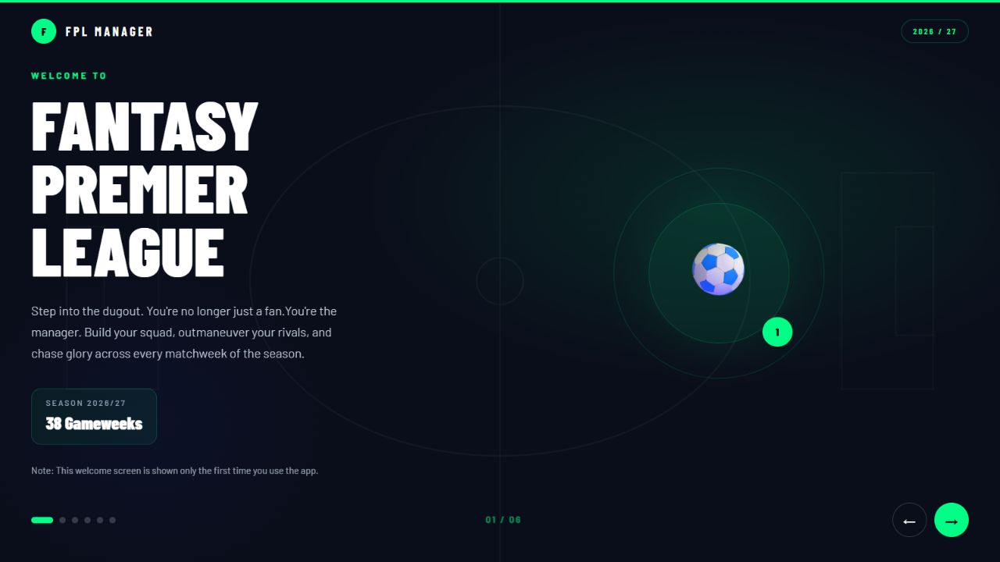
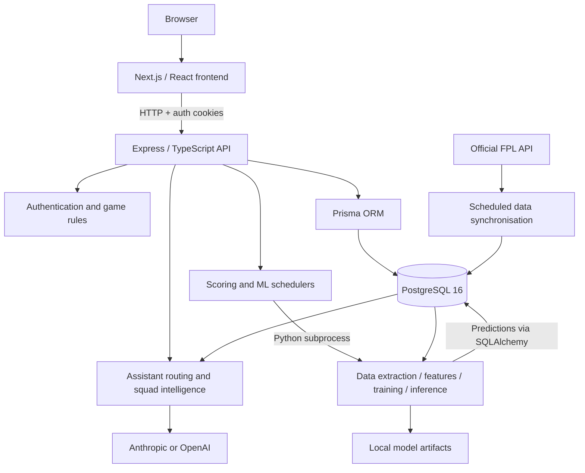

# FPL AI Coach

A full-stack Fantasy Premier League management app with an AI coaching assistant and a Python machine-learning pipeline. Built as a thesis project, it combines squad management, gameweek scoring, transfer planning, leagues, and data-driven recommendations.



*Screenshot of the running application's welcome screen.*

## Features

- Build and manage a 15-player squad, formations, captaincy, and bench order.
- Plan transfers and use Wildcard, Free Hit, Bench Boost, and Triple Captain chips.
- View fixtures, points, gameweek history, and private leagues.
- Ask the assistant for player comparisons, captain choices, transfer recommendations, and squad advice.
- Generate player availability and points predictions, with fixture context and constrained squad optimisation.
- Synchronise FPL data and run scheduled scoring and ML updates.

## Architecture



The frontend presents the manager UI and chatbot. The API owns authentication, team state, transfer and chip rules, scoring, leagues, and assistant orchestration. Prisma manages the application database schema. The assistant combines application context and prediction services with an optional LLM provider to explain recommendations.

The Python pipeline extracts player-gameweek history, builds lagged and rolling features, trains availability and points models, and writes predictions to PostgreSQL. Points inference combines appearance probability with conditional points estimates. The API launches the pipeline as a subprocess; trained models and datasets remain local. Scheduled jobs synchronise FPL data, score gameweeks, and refresh predictions after completed gameweeks.

## Repository layout

| Path | Purpose |
| --- | --- |
| `apps/web` | Next.js 16, React 19, TypeScript and Tailwind frontend |
| `apps/api` | Express API, assistant services, scheduled jobs and Vitest tests |
| `apps/api/prisma` | PostgreSQL schema and versioned migrations |
| `apps/ai` | Python feature engineering, training, inference and evaluation code |
| `packages/types` | Shared TypeScript types |
| `infra` | Docker Compose database configuration |
| `docs/images` | README screenshots |

Thesis documents, evaluation outputs, datasets, model binaries, environment secrets, build outputs, and laptop-sync duplicates are excluded from the source update. Evaluation scripts and tests are included for reproducibility.

## Run locally

Prerequisites: Node.js 20.9 or later, npm, Docker Compose, and Python 3.11 or 3.12 for the ML dependencies.

1. Clone this repository and install the workspace dependencies:

   ```bash
   git clone https://github.com/Ignatiostou/Fantasy_Premier_League_withAi_Chatbot_Thesis.git
   cd Fantasy_Premier_League_withAi_Chatbot_Thesis
   npm ci
   ```

2. Copy `apps/api/.env.example` to `apps/api/.env` and `apps/web/.env.example` to `apps/web/.env.local`. Replace both JWT placeholders with separate random secrets. Supply an API key for the selected LLM provider to enable generated assistant responses.

3. Start PostgreSQL, generate the Prisma client, and apply migrations:

   ```bash
   npm run db:up
   npm run prisma:generate -w apps/api
   npm run prisma:migrate
   npm run fpl:refresh -w apps/api
   ```

   The Compose credentials are local development defaults. Reference-data refresh requires access to the FPL API.

4. Start the frontend and API:

   ```bash
   npm run dev
   ```

   Open [localhost:3000](http://localhost:3000). The API listens on port 4001 and exposes `/health`. Register through the app to create a local manager account.

## Enable ML predictions

Create a virtual environment in `apps/ai/.venv`, install `apps/ai/requirements.txt`, and copy `apps/ai/.env.example` to `apps/ai/.env`. Configure its database URL for the same PostgreSQL instance. From `apps/ai`, using the virtual environment's Python:

```bash
python scripts/backfill_season.py --season YYYY-YY
python pipeline.py --full
python pipeline.py --predict-only
```

Replace `YYYY-YY` with the season currently served by FPL. Backfill downloads historical data and can take time. The API discovers the virtual environment on Windows and Unix; set `ML_PYTHON` to override the interpreter. Set `ML_AUTO_BACKFILL=true` in the API environment to enable automatic initial backfill. See [pipeline documentation](apps/ai/README.md) and [evaluation documentation](apps/ai/evaluation/README.md) for additional commands.

## Development checks

```bash
npm run build -w apps/api
npm test -w apps/api
npm run build -w apps/web
npm run lint -w apps/web
```

Python tests live in `apps/ai/tests`; run `python -m pytest tests` from `apps/ai` with its environment configured. Some evaluation suites require populated historical data or external services; inspect their prerequisites before running them. Do not run data-changing evaluations against a production database.

This is an independent educational project and is not affiliated with the Premier League or the official Fantasy Premier League game.
